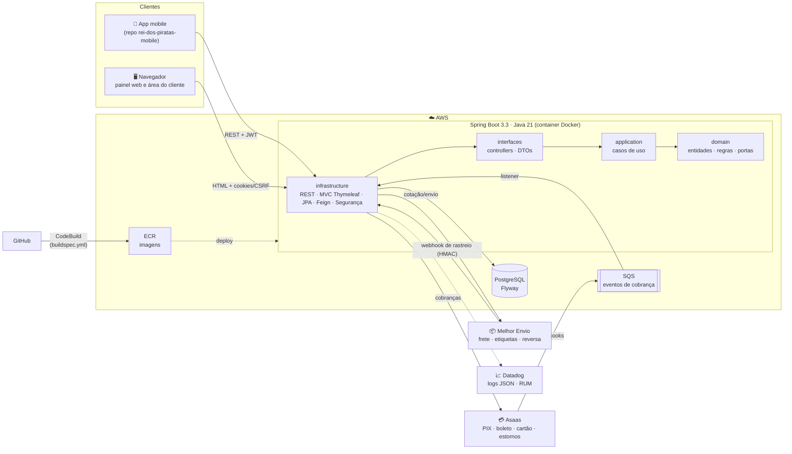

# 🏴‍☠️ Rei dos Piratas – E-commerce de Mangás


---

## 📌 Sobre o projeto

O **Rei dos Piratas** é uma loja de mangás, com foco em **One Piece**, que vende volumes **novos e usados**.
Hoje a operação acontece na Shopee:

👉 **Loja atual:** [shopee.com.br/rei_dos_piratas](https://shopee.com.br/rei_dos_piratas)

Este repositório é o **e-commerce próprio** que vai substituir a loja da Shopee. Ele inclui:

- a API REST, usada pelo aplicativo mobile;
- o painel web, usado pelos funcionários e pelos clientes;
- as integrações de pagamento e de frete.

O projeto nasceu no **Challenge Oracle – FIAP** (turma 2TDSPS-2025). Agora está evoluindo para **produção real na AWS**.

---

## 🎯 Objetivo

Levar a operação da Shopee para uma **infraestrutura própria**, **segura**, **escalável** e **financeiramente viável**:

- **Margem maior:** sem a comissão do marketplace.
- **Relacionamento direto** com o cliente: cadastro, histórico de pedidos e devoluções no próprio site.
- **Controle total do fluxo de venda:** estoque, cobrança, envio, cancelamento e estorno, com cada evento rastreável.

### 👤 Público-alvo

Leitores e colecionadores de mangás, principalmente jovens e adultos que consomem animes e cultura japonesa.

---

## 🧭 Escopo atual

### ✅ Implementado

**Cliente** (API para o app mobile + área do cliente no painel web)

- Cadastro e login: JWT com refresh token e sessões persistidas, com cookies na web.
- Catálogo de produtos e carrinho.
- Endereços de entrega e cartões salvos (o cartão fica tokenizado no Asaas; o número e o CVV nunca são guardados).
- Checkout com cotação de frete e três formas de pagamento:
  - **PIX**, com QR Code;
  - **boleto**, com vencimento configurável;
  - **cartão de crédito**, à vista ou parcelado, conforme a regra de parcelamento.
- Meus pedidos: status do pagamento e da entrega, rastreio, cancelamento e estornos.
- Devolução de itens: arrependimento ou defeito, com envio reverso pago pela loja.

**Funcionário / administrador** (painel web Thymeleaf)

- Cadastro, edição e estoque de produtos.
- Painel de pedidos:
  - pagamento e estornos;
  - compra e impressão da etiqueta de frete;
  - cancelamento.
- Análise de devoluções: aprovar ou recusar, pagar o frete de retorno, e concluir a devolução com estorno ao cliente.
- Perfis e permissões por função (roles).
- Simulador de eventos do Asaas e do Melhor Envio, para testes. **Nunca é ligado em produção.**

**Integrações e eventos**

- **Asaas:** cobranças, tokenização de cartão e estornos.
  - Estornos totais e parciais.
  - No boleto, o estorno passa por um link em que o cliente informa os dados bancários.
  - Os webhooks de pagamento são consumidos por uma fila **AWS SQS**.
  - O processamento é idempotente: um evento repetido não tem efeito duplicado.
- **Melhor Envio:**
  - cotação, compra e geração de etiquetas;
  - logística reversa;
  - webhook de rastreio com assinatura HMAC.
- Regras automáticas:
  - o boleto ou PIX vencido cancela o pedido e devolve o estoque;
  - um pagamento que chega com o pedido já cancelado é estornado automaticamente.

### 🚧 Próximos passos

- Escolher o serviço de execução na AWS (ECS Fargate, App Runner ou Elastic Beanstalk) e criar a infraestrutura como código (Terraform ou CDK).
- Recuperação de senha.
- Expirar os pedidos de cartão que ficaram sem resposta do Asaas.
- Reprocessar estornos que falharam ou foram negados.
- Emissão de nota fiscal (NF-e).
- Promoções e cupons.

---

## 🗺️ Arquitetura



A regra de dependência é `infrastructure → interfaces → application → domain`, verificada pelo ArchUnit.

O fornecedor externo fica atrás de uma **porta de domínio**:

- `GatewayPagamento`: Asaas;
- `GatewayFrete`: Melhor Envio.

Quando a chamada move dinheiro, ela roda **fora da transação de banco**. Os detalhes estão em [AGENTS.md](AGENTS.md) e em [docs/refatoracao-clean-architecture.md](docs/refatoracao-clean-architecture.md).

> O diagrama da fase FIAP (Azure, Oracle e PagBank) foi mantido como histórico em [diagrama-arquitetura.png](diagrama-arquitetura.png).

---

## 🧱 Tecnologias

| Camada | Tecnologia |
|---|---|
| Linguagem | Java 21 |
| Framework | Spring Boot 3.3 (Web, Data JPA, Security, Validation, HATEOAS, Thymeleaf) |
| Clientes HTTP | Spring Cloud OpenFeign (2023.0) |
| Mensageria | Spring Cloud AWS 3.2: SQS |
| Banco de dados | PostgreSQL 18 (produção) · H2 em modo PostgreSQL (testes) |
| Migrations | Flyway |
| Autenticação | JWT (jjwt 0.12) + refresh token + sessões persistidas · cookies e CSRF na web |
| Front-end web | Thymeleaf + Tailwind CSS |
| Documentação da API | springdoc-openapi (Swagger UI) |
| Observabilidade | Logback + logstash-logback-encoder (JSON) · Datadog RUM |
| Testes | JUnit 5, Mockito, Spring Boot Test, ArchUnit, WireMock, JaCoCo · `node --test` para o JS |
| Build e entrega | Maven Wrapper · Docker (multi-stage, JRE 21) · AWS CodeBuild → ECR |
| Pagamentos | [Asaas](https://docs.asaas.com/) |
| Frete | [Melhor Envio](https://docs.melhorenvio.com.br/) |
| Mobile | App em repositório separado: [rei-dos-piratas-mobile](https://github.com/FIAP-1TDSPS-2024/rei-dos-piratas-mobile) |

---

## 📂 Estrutura do repositório

```
/
├── README.md, AGENTS.md, CLAUDE.md
├── buildspec.yml             AWS CodeBuild → imagem Docker → ECR
├── docs/                     decisões de arquitetura e refatoração
├── .claude/agents/           agentes de IA (análise e desenvolvimento back/front)
├── .github/workflows/, azure-pipelines.yaml   pipelines da fase FIAP (legado)
└── Java/rei-dos-piratas/     projeto Maven (API + painel web)
```

- Como rodar, variáveis de ambiente e endpoints: [README da aplicação Java](Java/rei-dos-piratas/README.md)
- Coleção do Postman: [API Rei dos Piratas.postman_collection.json](./Java/rei-dos-piratas/API%20Rei%20dos%20Piratas.postman_collection.json)

---

## 🧭 Método de trabalho

- Entregas incrementais, com base no Scrum.
- **TDD** em todo código novo: Red → Green → Refactor.
- **Clean Architecture**, com regras de camada verificadas automaticamente.

As convenções do projeto estão em [AGENTS.md](AGENTS.md).

---

## 🎓 Origem acadêmica – Challenge FIAP

[Vídeo explicativo da solução (YouTube)](https://www.youtube.com/watch?v=wSOUlz6PsAY)

### 👥 Integrantes do grupo – CATECH

- **RM561144**: Jonas Oliveira, responsável por Java e banco de dados
- **RM559336**: Wendell Dourado, responsável por Mobile e DevOps
- **RM559622**: Daniel Batista, responsável por .NET, IoT e QA

Na fase FIAP, o projeto usava **Azure**, **Oracle** e **PagBank**, e tinha um módulo **.NET** para gestão de funcionários e produtos. Nesta fase:

- o banco passou a ser **PostgreSQL**;
- os pagamentos passaram para o **Asaas**;
- o deploy está migrando para a **AWS**.

As pipelines da Azure continuam no repositório como legado.
